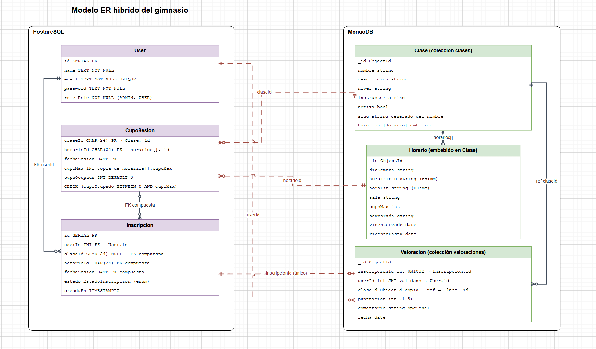

# Tarea individual U2 · Modelo híbrido PostgreSQL + MongoDB

**Caso 2 · Gimnasio**  

**Estudiante** José Andrés Reinoso Guerrero · **N.º de lista** 14

## 1. Workload

### 1.1 Casos de uso

- El socio consulta clases, horarios y valoraciones. Puede inscribirse a una sesión con cupo y cancelar antes de que empiece.
- El personal del gimnasio mantiene el catálogo y registra la asistencia al cerrar una sesión.
- Después de asistir, el socio puede dejar una valoración. El personal consulta la ocupación de las sesiones y el promedio de valoración por clase.

### 1.2 Datos principales (cuántos actores, cuántos registros, cuánto tiempo se guardan)

| Dato | Estimación |
|---|---:|
| Socios registrados | 2.000 |
| Administradores | 5 |
| Clases activas | 40 |
| Sesiones por semana | 120 (3 por clase) |
| Cupo promedio por sesión | 20 (2.400 plazas semanales) |
| Horizonte para estimar el volumen | 5 años (260 semanas) |

### 1.3 Suposiciones

- Se estiman tres intentos de inscripción por socio por semana. La demanda se concentra al abrir los cupos. Se proyectan unas 2.400 inscripciones aceptadas por semana, con posibilidad de volver a ocupar una plaza liberada.
- Se cancela el 10 % de las inscripciones aceptadas. Asiste el 90 % de quienes conservan su plaza y valora el 30 % de los asistentes. Cada inscripción asistida admite una valoración.
- El personal publica cada sesión antes de abrir las inscripciones. Cada sesión conserva el cupo y la referencia al horario con que se publicó. Los ajustes de temporada se aplican a sesiones aún sin publicar. La fecha y la hora se interpretan en la zona horaria local del gimnasio.
- Se conserva el historial de sesiones, inscripciones y valoraciones. Los cinco años son el horizonte de estimación del volumen. El catálogo admite desactivación y conserva los horarios asociados a sesiones publicadas.

### 1.4 Operaciones

| Actor | Operación | Lectura o escritura | Frecuencia estimada | Tasa aproximada | Datos | Base y motivo |
|---|---|---|---|---|---|---|
| Socio | Inscribirse a una sesión | Escritura | 3 intentos por socio por semana, con picos de 20 por minuto | 6.000 intentos y 2.400 aceptadas por semana | `userId`, `claseId`, `horarioId`, `fechaSesion`, hora de inicio y cupo | MongoDB aporta la hora de inicio. PostgreSQL reserva la plaza y guarda la inscripción en una transacción. |
| Socio | Cancelar una inscripción | Escritura | 10 % de las aceptadas | 240 por semana | `Inscripcion.id`, hora de inicio, estado y cupo | MongoDB aporta la hora de inicio. PostgreSQL cancela y libera la plaza en una transacción. |
| Socio | Consultar clases y horarios | Lectura | 5 consultas por socio por día | 10.000 por día | Nombre, nivel, `horarios[]` | MongoDB devuelve la ficha con sus horarios. |
| Socio | Valorar una clase a la que asistió | Escritura | 30 % de las asistencias | 583 por semana | `inscripcionId`, `userId`, `claseId`, puntuación, comentario, fecha | PostgreSQL confirma la asistencia y la titularidad. MongoDB guarda la valoración. |
| Socio | Ver valoraciones por clase | Lectura | 1 consulta por socio por día | 2.000 por día | `claseId`, puntuación, comentario, fecha | MongoDB filtra y pagina por clase. |
| Administrador | Consultar ocupación por sesión | Lectura | 4 consultas por administrador por día | 20 por día | Clave de sesión, `cupoOcupado`, `cupoMax` | PostgreSQL devuelve el cupo de la sesión publicada. |
| Administrador | Consultar promedio de valoración por clase | Lectura | 2 consultas por administrador por día | 10 por día | `claseId`, puntuación | MongoDB agrupa las valoraciones por clase. |
| Administrador | Crear o editar clases y horarios | Escritura | Cambios de catálogo según la temporada | 5 por semana | Nombre, descripción, nivel, instructor, `horarios[]` y sesiones publicadas | MongoDB guarda la clase y sus horarios. Al editar horarios, PostgreSQL indica cuáles ya tienen sesiones publicadas y deben conservarse. |
| Administrador | Publicar una sesión | Escritura | 3 sesiones por clase por semana | 120 por semana | `claseId`, `horarioId`, `fechaSesion`, `cupoMax` | MongoDB aporta el horario y cupo. PostgreSQL guarda la sesión. |
| Administrador | Registrar asistencia al cerrar la sesión | Escritura | Al cierre de cada sesión | 120 cierres, unas 2.160 inscripciones por semana | Clave de sesión, hora de fin, `Inscripcion.id` y estado | MongoDB aporta la hora de fin. PostgreSQL registra asistencia y ausencia sobre las inscripciones activas. |

### 1.5 Entidades

- **PostgreSQL.** `User` identifica a socios y administradores. `CupoSesion` identifica una sesión mediante `claseId`, `horarioId` y `fechaSesion`, y conserva su capacidad y ocupación. `Inscripcion` relaciona un socio con una sesión publicada.
- **MongoDB.** `Clase` es el catálogo y contiene `horarios[]`. Cada horario tiene su propio `_id` y define una recurrencia semanal. `Valoracion` es una colección independiente y referencia a `Clase`.
- **Entre bases (sin FK)** `CupoSesion` conserva las referencias a la clase y su horario. `Valoracion` conserva la referencia a la inscripción asistida y a su socio.

### 1.6 Observaciones (qué domina: lectura o escritura, qué crece sin límite, qué necesita integridad)

- Dominan las lecturas del catálogo y las valoraciones. Las escrituras de inscripción requieren integridad transaccional porque varios socios pueden solicitar la última plaza al mismo tiempo.
- De 2.400 inscripciones aceptadas por semana, unas 2.160 conservan su plaza y unas 1.944 se convierten en asistencias. El 30 % de 1.944 da aproximadamente 583 valoraciones por semana.
- A cinco años se estiman 31.200 sesiones, 624.000 inscripciones y unas 152.000 valoraciones. Las valoraciones siguen creciendo como colección independiente y el historial transaccional también se acumula. El arreglo `horarios[]` describe la programación, no almacena sesiones fechadas.

## 2. ¿PostgreSQL o MongoDB?

| Entidad | ¿Necesita transacciones? | ¿Necesita claves foráneas? | ¿Tiene forma variable? | ¿Cuánto crece? | ¿Predomina lectura o escritura? | Decisión |
|---|---|---|---|---|---|---|
| `User` | El login lee una cuenta. Las altas conservan el correo único. | Sí. `Inscripcion.userId` exige una cuenta existente. | No. Tiene los campos y roles del proyecto base. | Aproximadamente 2.005 cuentas iniciales. Crece con las altas. | Lectura en autenticación y consultas de titularidad. | PostgreSQL. Se reutiliza el modelo de Prisma. |
| `CupoSesion` | Sí. Varias inscripciones pueden competir por la misma fila. | Sí. `Inscripcion` depende de su clave compuesta. | No. Una fila por sesión fechada. | 120 filas por semana, unas 31.200 en cinco años. | Escritura al reservar o liberar plazas y lectura para ocupación. | PostgreSQL. |
| `Inscripcion` | Sí. El cambio de estado y el ajuste de cupo se confirman juntos. | Sí. Apunta a `User`. Para inscribir en el gimnasio, la API exige una sesión publicada y la FK compuesta protege esa referencia. | No. Sus campos y estados están definidos. | Unas 624.000 filas en cinco años, incluidas las canceladas. | Escritura en picos de inscripción, cancelación y cierre. | PostgreSQL. |
| `Clase` | Las ediciones del catálogo afectan un documento a la vez. | Tiene referencias lógicas desde PostgreSQL y desde `Valoracion`. | Sí. La cantidad de horarios puede variar por clase y temporada. | Unas 40 clases activas, más el historial de catálogo. | Lectura de catálogo, unas 10.000 consultas por día. | MongoDB. |
| `Valoracion` | Basta la escritura de un documento. Un índice único evita duplicados por inscripción. | Referencia a `Clase` en MongoDB. Las referencias a PostgreSQL las valida el servicio. | No. Tiene una estructura estable y admite un comentario opcional. | Unas 152.000 en cinco años. Sigue creciendo con cada sesión. | Altas continuas y más lecturas por clase (unas 2.000 por día). | MongoDB, en una colección propia. |

**Control de cupo.** Al publicar una sesión, el servicio valida que el horario pertenezca a una clase activa, que la fecha esté entre `vigenteDesde` y `vigenteHasta` y que coincida con el día de la semana. Guarda `cupoMax` como capacidad fija de esa sesión y comienza con `cupoOcupado = 0`. La clave compuesta identifica la fila y la base exige que `cupoOcupado` esté entre cero y `cupoMax`, inclusive.

Para inscribir, el servicio toma `userId` del JWT, valida la clase y el horario en MongoDB y consulta la hora de inicio. Bloquea la fila de la sesión en PostgreSQL, comprueba que la sesión aún pueda recibir inscripciones y que `cupoOcupado < cupoMax`. En la misma transacción crea la inscripción `ACTIVA` e incrementa el contador. Para cancelar, verifica la titularidad y la hora de inicio. Luego bloquea la fila de la sesión, cambia la inscripción de `ACTIVA` a `CANCELADA` una sola vez y decrementa el contador dentro de la misma transacción. El índice único parcial admite una sola inscripción vigente por socio y sesión y permite volver a reservar después de cancelar si quedan plazas. Al cerrar la sesión, el servicio consulta la hora de fin en MongoDB y cambia las inscripciones `ACTIVA` a `ASISTIDA` o `NO_ASISTIO` en PostgreSQL. El contador conserva las plazas reservadas al inicio para el reporte histórico.

## 3. Relaciones dentro de MongoDB: embeber o referenciar

| Relación | Cardinalidad | ¿Cómo se lee? | ¿Cómo se escribe? | ¿Se pide junto o por partes? | ¿Cuánto crece? | Decisión |
|---|---|---|---|---|---|---|
| `Clase` → `horarios[]` | Una clase tiene de cero a muchos horarios. Cada horario pertenece a una sola clase. | La ficha muestra los horarios de la clase. | El administrador agrega o actualiza la programación por temporada. Un horario publicado conserva su identidad y los datos de la programación original. | Junto con la ficha de la clase. | Crece con cambios de programación. Cada horario puede reutilizarse en varias sesiones fechadas. | Embeber subdocumentos con `_id` propio. |
| `Clase` → `Valoracion` | Una clase tiene de cero a muchas valoraciones. Cada valoración corresponde a una sola clase. | Se listan por clase, con paginación y orden por fecha. También se calcula su promedio. | Se agrega un documento por inscripción asistida que recibe una valoración. | Por partes, según la página o el reporte. | Sigue creciendo con el historial. | Referenciar mediante `Valoracion.claseId` (`ObjectId`) en una colección propia. |

## 4. ERD híbrido (notación pata de gallo, como el material 2.1)

[Diagrama en Draw.io](gimnasio_er_hibrido.drawio)

## 5. Referencias

| Referencia | Cómo se guarda | Quién garantiza que exista | Cómo se une |
|---|---|---|---|
| `Inscripcion.userId` → `User.id` | `INT` obligatorio, FK | PostgreSQL mediante la FK. | `JOIN` o `include` de Prisma. |
| `Inscripcion.(claseId, horarioId, fechaSesion)` → PK de `CupoSesion` | FK compuesta de dos `CHAR(24)` y un `DATE`. `claseId` admite `NULL` en PostgreSQL y se declara `String?` en Prisma. | La API del gimnasio exige los tres valores y una sesión publicada. PostgreSQL verifica la FK cuando se guardan los tres valores. | `JOIN` o `include` por las tres columnas. Para resolver el catálogo de una inscripción se usan las referencias de su sesión. |
| `CupoSesion.claseId` → `Clase._id` | `CHAR(24)` con el `ObjectId` en hexadecimal, parte de la PK | El servicio valida la clase al publicar la sesión. | Se convierten los ids a `ObjectId` y se busca `Clase` con `$in`. El servicio combina los resultados en memoria. |
| `CupoSesion.horarioId` → `Clase.horarios[]._id` | `CHAR(24)` con el `ObjectId` del subdocumento, parte de la PK | El servicio comprueba que el horario pertenezca a la clase y sea válido para la fecha de la sesión. | En la clase recuperada con `$in` se busca el subdocumento por `_id`. |
| `Clase.horarios[]` → horario embebido | Arreglo de subdocumentos con `_id` propios | El esquema de Mongoose valida la estructura al guardar la clase. El horario existe dentro de ella. | Se lee el mismo documento y se selecciona el subdocumento por `_id` cuando corresponde. |
| `Valoracion.inscripcionId` → `Inscripcion.id` | Entero (`Number` en Mongoose), obligatorio y único | El servicio exige que la inscripción exista, esté `ASISTIDA` y pertenezca al socio autenticado. El índice único evita dos valoraciones por inscripción. | `findMany` de Prisma con `id: { in: ids }` y combinación en memoria. |
| `Valoracion.userId` → `User.id` | Entero (`Number` en Mongoose), obligatorio, tomado del JWT | El servicio verifica que el `userId` del JWT coincida con `Inscripcion.userId`, cuya FK a `User` valida PostgreSQL. | `findMany` de Prisma con `id: { in: ids }` si se necesitan datos de la cuenta. |
| `Valoracion.claseId` → `Clase._id` | `ObjectId` obligatorio con `ref` a `Clase` | El servicio lo toma de la inscripción validada, lo convierte a `ObjectId` y comprueba que la clase exista. | `populate('claseId')` o consulta por lote con `$in`. |

El modelo conserva las cuentas, clases, horarios publicados, sesiones e inscripciones que sustentan referencias del historial. El catálogo se desactiva para impedir nuevas publicaciones y las cancelaciones cambian el estado de la inscripción. Así las sesiones y valoraciones históricas pueden seguir resolviendo sus referencias.

En PostgreSQL, la PK de `CupoSesion` permite localizar la fila que controla el cupo. El índice de `Inscripcion` por `(claseId, horarioId, fechaSesion)` agiliza la consulta de inscritos para el cierre. En MongoDB, el índice único de `inscripcionId` limita las valoraciones y el índice `(claseId, fecha descendente)` facilita su lectura por clase.

## 6. Datos copiados entre bases (desnormalización)

| Dato | Origen → destino | Operación que lo usa | Costo |
|---|---|---|---|
| `cupoMax` | `Clase.horarios[].cupoMax` (MongoDB) → `CupoSesion.cupoMax` (PostgreSQL) | Abrir inscripciones, reservar plazas y consultar la ocupación con un cupo estable en PostgreSQL. | Se guarda un entero por sesión y se lee MongoDB al publicarla. Una sesión ya publicada conserva su cupo original. Los ajustes del horario se aplican a sesiones futuras aún sin publicar. |
| `claseId` | `Inscripcion.claseId` (PostgreSQL) → `Valoracion.claseId` (MongoDB) | Listar valoraciones y calcular el promedio por clase en MongoDB. | Se guarda e indexa un identificador adicional por valoración. El servicio convierte a `ObjectId` la copia tomada de la inscripción, cuya clase permanece fija. |

El `userId` de la valoración se guarda como referencia validada. Procede del JWT y el servicio lo compara con el titular de la inscripción en PostgreSQL.

## 7. Endpoints

| Método y ruta | Base(s) | Respuestas posibles |
|---|---|---|
| `POST /api/auth/register` | PostgreSQL | `201` cuenta de socio creada, `400` datos inválidos, `409` correo duplicado. |
| `POST /api/auth/login` | PostgreSQL | `200` JWT, `400` datos inválidos, `401` credenciales incorrectas. |
| `POST /api/clases` | MongoDB | `201` clase creada, `400` datos inválidos. Requiere administrador. |
| `GET /api/clases` | MongoDB | `200` catálogo filtrado, ordenado y paginado, `400` consulta inválida. Admite `q`, `fields` y `orden`. |
| `GET /api/clases/:id` | MongoDB | `200` ficha de la clase, `400` id inválido, `404` clase inexistente. |
| `PUT /api/clases/:id` | PostgreSQL y MongoDB | `200` clase actualizada, `400` datos inválidos, `404` clase inexistente, `409` el cambio afecta un horario publicado. Requiere administrador. |
| `DELETE /api/clases/:id` | PostgreSQL y MongoDB | `204` clase y valoraciones asociadas eliminadas, `400` id inválido, `404` clase inexistente, `409` clase usada en PostgreSQL. Requiere administrador. |
| `POST /api/sesiones` | MongoDB y PostgreSQL | `201` sesión publicada con cupo, `400` fecha o datos inválidos, `404` clase u horario inexistente, `409` clase desactivada o sesión duplicada. Requiere administrador. |
| `GET /api/sesiones` | PostgreSQL | `200` cupo y ocupación de las sesiones, `400` filtros inválidos. Admite `claseId`. |
| `PATCH /api/sesiones/asistencia` | MongoDB y PostgreSQL | `200` conteo de asistencias y ausencias, `400` datos inválidos, `404` sesión, clase u horario inexistente, `409` sesión en curso o inscripciones inválidas para el cierre. Requiere administrador. |
| `POST /api/inscripciones` | MongoDB y PostgreSQL | `201` inscripción creada, `400` datos inválidos, `404` clase, horario o sesión inexistente, `409` sesión iniciada, llena o ya reservada por el socio. Requiere JWT. |
| `GET /api/inscripciones` | PostgreSQL y MongoDB | `200` inscripciones con clase y horario, `400` paginación inválida. El socio ve las suyas y el administrador puede ver todas. Requiere JWT. |
| `PATCH /api/inscripciones/:id/cancelar` | MongoDB y PostgreSQL | `200` inscripción cancelada, `400` id inválido, `403` inscripción ajena, `404` inscripción, clase, horario o sesión inexistente, `409` sesión iniciada o inscripción que ya no está activa. Requiere JWT. |
| `POST /api/valoraciones` | PostgreSQL y MongoDB | `201` valoración creada, `400` datos inválidos, `403` inscripción ajena, `404` inscripción o clase inexistente, `409` falta de asistencia o valoración duplicada. Requiere JWT. |
| `GET /api/valoraciones?claseId=...` | MongoDB | `200` valoraciones ordenadas con datos de la clase, total y promedio, `400` consulta inválida, `404` clase inexistente. |

Las rutas autenticadas reciben `Authorization: Bearer <JWT>`. Responden `401` cuando falta el token y `403` si el token es inválido, expiró o carece del rol requerido.

- **Catálogo.** `q` busca un fragmento del nombre. `fields` recibe nombres de campos separados por coma. `orden` admite `nombre`, `-nombre`, `nivel` y `-nivel`. Los niveles válidos son `BASICO`, `INTERMEDIO` y `AVANZADO`.
- **Sesiones.** Para publicar o inscribir se envían `claseId`, `horarioId` y `fechaSesion` en formato `AAAA-MM-DD`. El cierre añade `asistieron`, un arreglo de ids de inscripción. Para inscribir y cancelar, el servicio lee la hora de inicio del horario en MongoDB y la compara con la hora local del gimnasio. El cierre consulta la hora de fin.
- **Valoraciones.** Se envían `inscripcionId`, `puntuacion` de 1 a 5 y, de forma opcional, `comentario`. La API identifica al socio por el JWT y toma la clase de su inscripción.
- **Paginación.** Las listas admiten `pagina` y `limite`. Por defecto devuelven la primera página con hasta 50 registros.
